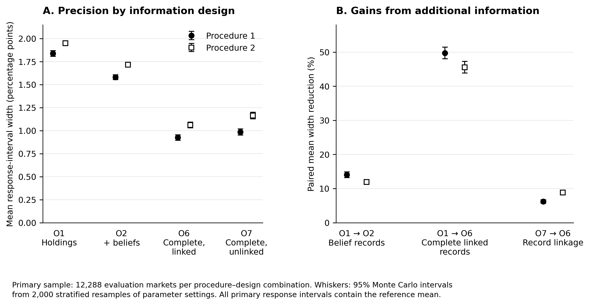

# Investor information and uncertainty about Bitcoin price responses

Replication code and synthetic data for the working paper by **Murray A. Rudd** (October 15, 2026).

The experiment asks how investor information changes uncertainty about a model-implied Bitcoin price response to an external cash transfer. Four observation designs distinguish holdings alone, holdings with beliefs, complete linked records, and complete unlinked records. Two independently trained procedures analyze the same evaluation markets. The model is a controlled research environment; its results are not estimates of actual Bitcoin adoption or forecasts of Bitcoin prices.

**Release package:** 1.0.0 · **Main experiment:** 0.6.0 · **Final calibration:** 0.5.0. These version numbers describe different stages. The large Monte Carlo results come from experiment 0.6.0, completed October 13, 2026.

## Start here

To inspect the completed results, open [the main summary table](reference/panel_summary.csv), [paired information contrasts](reference/paired_contrasts.csv), or [the results map](docs/RESULTS_MAP.md). The repository includes the plotting code and rendered figures. No simulation download is needed to read these files.



The main sample contains 192 parameter settings and 64 evaluation markets per setting. Every procedure–design combination uses the same 12,288 primary evaluation markets. Belief records reduce mean interval width by about 12–14%; complete linked records reduce it by about 46–50% relative to holdings alone. The incremental linkage gain is about 6–9%. These are conditional simulation results under the declared model and sampling design. The [results map](docs/RESULTS_MAP.md) explains the denominators and uncertainty measures.

## Install and reproduce the tables

The verified environment is Linux, Python 3.12.14, and the package versions in [requirements.txt](requirements.txt). The compiled market-clearing kernel requires `g++`. On Windows, run the computational commands inside WSL2 with a Linux Python installation. Uploading this package to GitHub does not require WSL or Python.

1. Download or clone this repository.
2. Open its **Releases** page and download `monte-carlo-results-v0.6.0.zip` from release **v1.0.0**. Put the ZIP in a new `assets/` folder at the repository root. Leave it compressed.
3. Open a terminal at the repository root and run:

```bash
python3.12 -m venv .venv
source .venv/bin/activate
python -m pip install -r requirements.txt
python reproduce.py quick
```

The `quick` route verifies the retained inputs, rebuilds the main summaries from saved simulation and fitted-interval records, compares 9,116 summary rows with the archived values, and redraws both figures. Results appear in `work/quick/results/confirmation_v06/summary/`; figures appear in `work/quick/figures/`. It does not repeat the full simulation.

For a public GitHub clone, `python reproduce.py fetch` can download the main asset automatically after release v1.0.0 has been published. Use `--all-assets` to include calibration data. A downloaded source ZIP needs `--repository OWNER/REPO`. Manual download also works for private repositories you can access.

## Reproduction routes

| Command | Purpose | Required Release assets |
|---|---|---|
| `python reproduce.py check --source-only` | Check all 49 archived source and test files | None |
| `python reproduce.py check` | Check source and both data-archive checksums | Both |
| `python reproduce.py figures` | Draw both figures from the repository's small summary tables | None |
| `python reproduce.py quick` | Rebuild main tables and figures from retained results | Main |
| `python reproduce.py verify` | Run 34 original tests, selected exact replays, freeze checks, and both sets of summaries | Both |
| `python reproduce.py refit` | Refit the observation and response models and final cutoffs using saved training and calibration draws | Both |
| `python reproduce.py full --workers 4` | Regenerate the full main experiment from frozen models and the original seeds | Main |

The first six routes were checked during packaging. The `full` route is supplied for independent reruns; the four-hour experiment was not repeated for packaging. It runs 296,960 simulated markets and constructs 131,072 response intervals. Allow several hours; hardware and worker count affect runtime. The [reproduction guide](docs/REPRODUCING.md) gives scope, outputs, storage needs, and troubleshooting.

## Repository and data layout

| Location | Contents |
|---|---|
| `engine/` | Byte-identical scientific source, original tests, and computational summary scripts |
| `reproduce.py` | Release preparation, checksum checks, and reproduction commands |
| `reference/` | Small main-run summary tables and integrity record |
| `publication/` | Figure code and rendered PNG, PDF, and SVG files |
| `docs/` | Reproduction instructions, data definitions, and links between the paper and outputs |
| `docs/history/` | Original development protocols; these describe their historical stages |
| `provenance/` | Archived status records, source checksums, and package validation |
| Release attachments | Complete retained numerical archives, including the larger training banks |

The two data assets are approximately **96 MiB** and **336 MiB**. They are Release attachments, not Git-tracked files, and do not require Git LFS. `release-assets.json` gives their exact sizes, SHA-256 hashes, contents, and source-archive provenance. The `assets/` and `work/` folders are excluded from Git.

## Interpretation and reproducibility boundaries

The primary mixture, boundary stress samples, preliminary validation, and final calibration are distinct. All 98,304 primary intervals contained their independent reference mean, with no empty primary intervals. This observation does not establish uniform coverage across the continuous parameter domain. Monte Carlo intervals describe uncertainty in performance estimates conditional on two fitted procedures. They do not incorporate retraining variability or establish empirical validity for real investors.

The package retains the completed working-paper experiment. Measurement-error experiments, changes in the linkage mechanism, empirical calibration sensitivity, and realistic market stress tests remain extensions. They are not presented as completed results.

## Citation and release status

Rudd, M. A. 2026. *Investor information and uncertainty about Bitcoin price responses*. Working paper, October 15.

Citation metadata are in [CITATION.cff](CITATION.cff). No paper DOI or public manuscript URL had been assigned to this package at preparation. See [LICENSE.md](LICENSE.md) for the current license status. [CHANGELOG.md](CHANGELOG.md) records packaging changes separately from the frozen scientific source.
